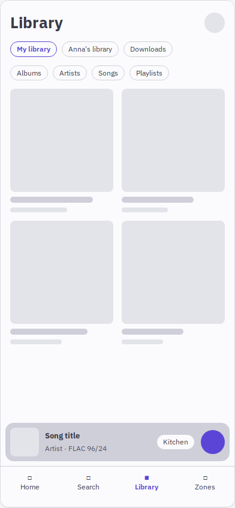
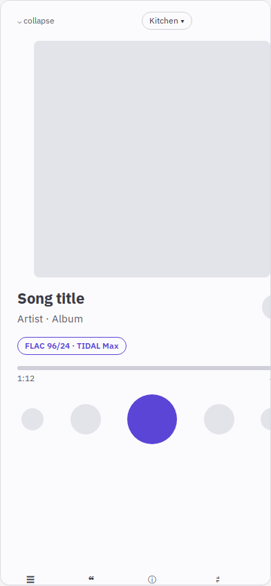
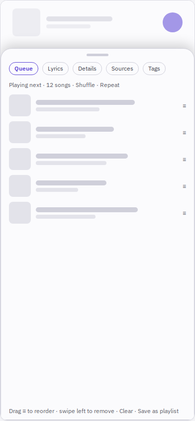
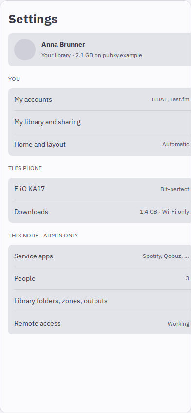
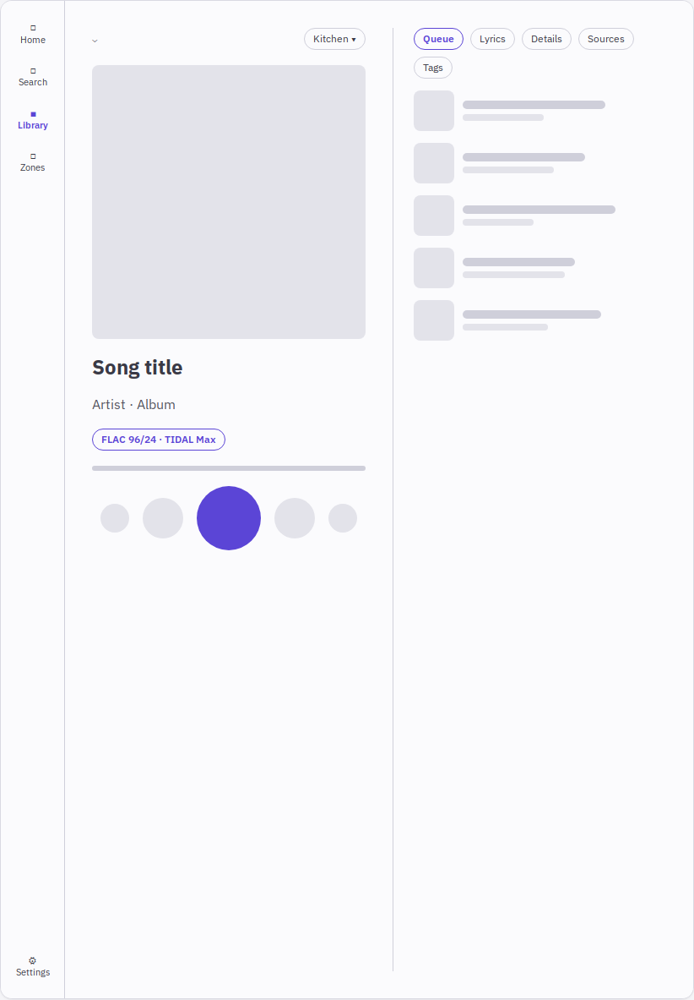
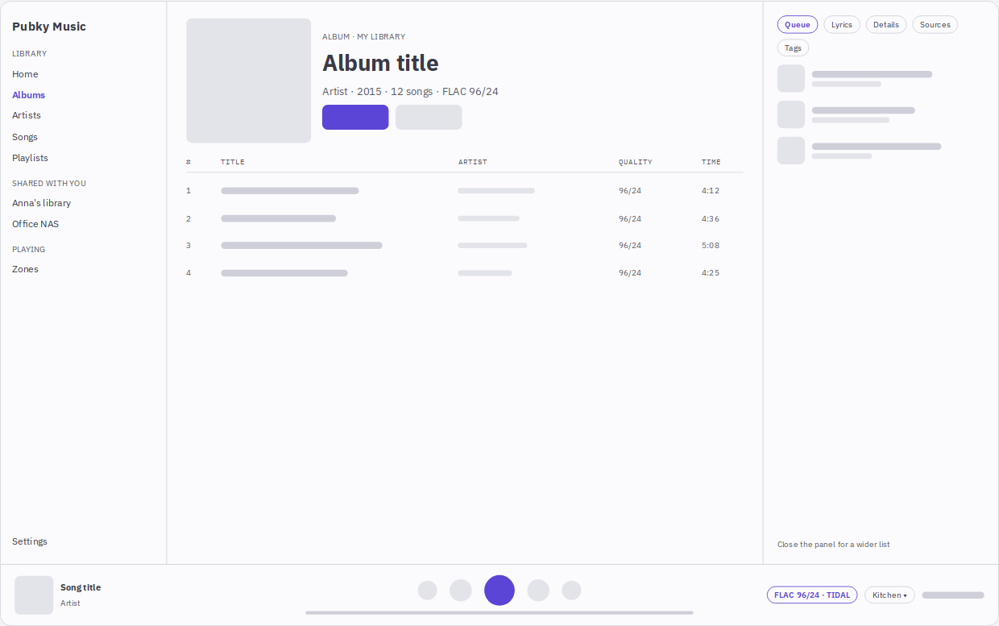

# One design for phone, tablet and desktop (design note, step 1)

STEWARD-UX-RESPONSIVE.md step 1. **Waiting for the owner's look before anything is built.** The same note as a page, with the wireframes scaled side by side: `responsive/note.html` (published for the owner; link in ~/QUESTIONS.md). The study behind it: `mobile-study.md`.

## Rules
- **Screens don't scroll; lists do.** Now playing, the quality sheet and the zone picker fit the screen. Library, album, artist, playlist and search scroll; their headers fold into a compact bar.
- **Secondary things are sheets.** Queue, Lyrics, Details (signal path, file, credits), Sources (also on) and Tags open over Now playing: a bottom sheet on a phone, a side panel on a tablet, a docked panel on a desktop.
- **Thumbs first.** 44 px targets; transport and the secondary row in the bottom half; swipe a row for Play next, long-press for its menu.
- **Same parts at every width;** only the arrangement and density change. Safe areas, both themes, reduced motion, font scale 1.3.

## Phone (under 600 px)
| Library, mini player, tab bar | Now playing, one screen | A sheet over Now playing | Settings, one grouped list |
| :-: | :-: | :-: | :-: |
|  |  |  |  |

- **Tabs:** Home, Search, Library, Zones. The mini player above them carries the quality and the zone.
- **Library:** my library first; shared libraries and Downloads as their own sections.
- **Now playing:** art; title with the heart; the quality label (opens the quality sheet); scrubber; transport. One row opens the five sheets; swipe down collapses it.
- **Settings:** yours first, then this phone, then the node's admin screens.

## Tablet (600–1024 px)

A rail instead of tabs. Now playing in two columns: the player left, the sheet as a side panel right. Lists become two-column grids.

## Desktop (over 1024 px)

- **Arrangement:** a sidebar (with a "Shared with you" group), dense lists with columns (title, artist, quality, time), the queue/lyrics/details panel docked right, and the player bar along the bottom.
- **Now playing:** a full view with the panel beside the art.

## Layout option
Settings › Home and layout:
- **Layout:** Automatic, Compact or Comfortable.
- **Dense lists**, on tablets and desktops.
- **Home rows.**

Per person, saved on their homeserver (STEWARD-MULTI-USER.md).

## Decisions for the owner
1. **The fourth tab:** Zones (drawn), or Queue?
2. **Now playing's background:** a colour from the cover, or plain?
3. **Swipe gestures on rows,** or long-press only?
4. **Lyrics:** in place of the art, or in the sheet (drawn)?

## Build order after the look
Each step is one PR:
1. the shell;
2. Now playing and its sheets;
3. lists;
4. Settings.

Each step gets screenshots at 390, 820 and 1440 px in both themes, and runs the overlap, accessibility and click-every-button checks at all three widths.
